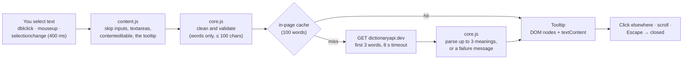

<div align="center">


# ContextLex

**Double-click a word on any web page and read its definition right next to it.**

A Chrome extension (Manifest V3) that shows a dictionary definition in a small tooltip beside the word you selected.
It has no settings, no background script, no runtime dependencies and no build step. Definitions come from the
[Free Dictionary API](https://dictionaryapi.dev/).

<!-- screenshot: TODO when on AC power (the tooltip open on a real page, light and dark theme) -->

**[Install from source](#install-from-source)** ·
**[What it does](#what-it-does)** ·
**[Privacy](#privacy)** ·
**[How it works](#how-it-works)**

[](https://github.com/abhiishek-sharma/ContextLex/actions/workflows/ci.yml)


[](LICENSE)

</div>

---

<details>
<summary><b>Contents</b></summary>

- [Install from source](#install-from-source)
- [What it does](#what-it-does)
- [Usage](#usage)
- [How it works](#how-it-works)
- [Privacy](#privacy)
- [Permissions](#permissions)
- [Where it works](#where-it-works)
- [Accessibility](#accessibility)
- [Limitations](#limitations)
- [Development](#development)
- [License](#license)

</details>

## Install from source

1. Clone or download this repository.
2. Open Chrome and go to `chrome://extensions/`.
3. Turn on **Developer mode** with the toggle in the top-right corner.
4. Click **Load unpacked**.
5. Select the `ContextLex` folder.

Nothing needs to be installed or built first.

<details>
<summary><b>Updating</b></summary>

1. Pull the latest changes or download the repository again.
2. Go to `chrome://extensions/`.
3. Click the refresh icon on the ContextLex card.
4. Refresh any open tabs to reload the content script.

</details>

## What it does

- **Double-click a word** to see its definition in a tooltip next to it: the word, its phonetic spelling when the API
  has one, and up to three meanings (the first definition of each of the first three parts of speech), each with an
  example sentence when the API has one.
- **Select a few words** and the first three are looked up one by one and listed together. This is not a phrase
  lookup: "ice cream" shows the meaning of "ice" and the meaning of "cream".
- **It stays in view.** The tooltip opens below the selection, moves above it when there is no room below, and is
  kept inside the visible area with an 8px margin where it fits.
- **It gets out of the way.** It closes when you click elsewhere, scroll the page or press Escape. Looking up another
  word replaces it.
- **Light and dark** styles follow the system theme (`prefers-color-scheme`).
- **One request per word per page.** A word that has been answered is not requested again on the same page. Answers
  (definitions and "not found") are kept in memory, up to 100 words, until the page is reloaded or closed.
- **No hanging "Loading...".** A lookup is given 8 seconds. Starting a new lookup or closing the tooltip cancels the
  request that is still running.
- **Clear failures.** "No definition found", being offline, a timeout and a failed request each show their own
  message.
- **Not while you type.** Text you select inside an input, a textarea or a contenteditable editor is not looked up.

## Usage

1. Open any web page.
2. Double-click a word you want to define.
3. Read the definition in the tooltip that appears.
4. Click anywhere else, scroll, or press Escape to close it.

A lookup starts for any selection that is made only of words: letters (A to Z and Latin-1 accented letters such as é),
hyphens, apostrophes and spaces, up to 100 characters. It does not matter whether you selected by double-clicking, by
dragging, or with the keyboard or touch (those two start the lookup after a 400 ms pause). A selection that contains
anything else (digits, punctuation, other alphabets) is ignored.

## How it works



The code is split in two so that everything that can be tested without a browser is:

- **`core.js`** holds the logic that needs no DOM: cleaning and validating the selected text, deciding whether a
  selection belongs to an editable field, parsing the API response, the lookup itself (cache, timeout, cancellation,
  failure messages) and the positioning maths. Chrome loads it as the first content script. The tests load the same
  file with `require()`, and once more together with `content.js` in a `node:vm` context.
- **`content.js`** connects that logic to the page: selection events, building the tooltip with DOM nodes
  (`textContent`, never HTML strings) and dismissing it.

## Privacy

ContextLex sends the words you select to a third-party service, so here is exactly what leaves your browser.

| | |
|---|---|
| **What is sent** | The selected word, lower-cased, as part of the address of a `GET` request to `https://api.dictionaryapi.dev/api/v2/entries/en/<word>`. For a selection of several words there is one request per word, for the first three words only. |
| **When** | Every time a selection starts a lookup (see [Usage](#usage)), not only on double-click. Selecting a name to copy it, for example, sends that name. Words answered from the in-page cache are not sent again. |
| **What the extension does not send** | The page address, the surrounding text, cookies or any identifier. Requests are made with `credentials: "omit"` and `referrerPolicy: "no-referrer"`. |
| **What the browser adds anyway** | The request is made from the page you are on, so like any request from a web page it carries your IP address and the browser's standard headers. One of them is `Origin`, which names the site you are reading (its domain, not the page address). |
| **What is stored** | Nothing that outlives the page. The extension's cache lives in the memory of the page and disappears with it, and requests are made with `cache: "no-store"`, so the browser's HTTP cache does not keep the answers either. The extension uses no storage API, has no background script and contains no analytics. |

ContextLex has no control over what dictionaryapi.dev logs.

## Permissions

`manifest.json` requests no API permissions (`"permissions": []`) and no `host_permissions`.

It does declare its content script for `<all_urls>`. That is how the extension sees the text you select and draws the
tooltip, and it means Chrome treats the extension as having access to all sites (see **Site access** on the
extension's details page).

## Where it works

The content script runs in the top frame of ordinary web pages. It does not run on:

- Chrome internal pages (`chrome://`)
- the Chrome Web Store
- PDF documents opened in the browser
- local files, unless **Allow access to file URLs** is turned on in the extension's details
- content inside iframes (the manifest does not set `all_frames`)

## Accessibility

- The tooltip is a polite live region (`role="status"`, `aria-live="polite"`, `aria-atomic="true"`) with `aria-busy`
  set while loading, so a screen reader can read the definition when it arrives without focus moving. It is marked
  `lang="en"`.
- Escape closes it.
- It has no animation. Under `prefers-reduced-motion: reduce` the stylesheet also blocks transitions and animations
  that a page's own CSS might apply to it.

This has not been tested with a screen reader yet.

## Limitations

- English only: the extension uses the English endpoint of the API.
- It needs a network connection, except for words already looked up on the same page.
- Several selected words are looked up word by word, not as a phrase, and only the first three.
- A drag selection that includes punctuation or digits (for example `word,`) is ignored.
- The check for form fields looks through open shadow roots only. A field inside a closed shadow root is not
  recognised.
- Only scrolling the page closes the tooltip. Scrolling inside a nested scrollable area does not, and the tooltip does
  not follow the text if the layout changes (for example when the window is resized).
- The tooltip is placed with `position: absolute` in page coordinates. On a site that gives `<body>` a CSS `position`
  (such as `relative`) and moves it away from the top-left corner of the page, for example with a margin, the tooltip
  is shifted by that same distance.
- The tooltip is an element in the page, styled by a normal stylesheet, so a site's own CSS can change how it looks.
- The Free Dictionary API is a free service with rate limits. When it refuses or fails a request, the tooltip shows an
  error message with the HTTP status.
- Not checked on sites with a strict Content Security Policy. If a page blocks the request, the tooltip shows the
  "Could not reach the dictionary" message.

## Development

The extension itself needs no tooling. Node.js 22 or newer is only needed to run the tests and scripts, and there is
nothing to `npm install`.

| Command | What it does |
|---|---|
| `npm test` | Runs the tests with `node --test` |
| `npm run check` | Runs `node --check` on every `.js` file and parses every `.json` file |
| `npm run icons` | Redraws the PNG icons in `icons/` |

GitHub Actions (`.github/workflows/ci.yml`) runs `npm run check` and `npm test` on pushes to `main` and on pull
requests, on Node 22, 24 and 26. Locally, `npm test` runs 93 tests in 17 suites (Node 26, 20 Nov 2026).

<details>
<summary><b>What the tests cover</b></summary>

- `test/core.test.js` covers `core.js`, using a stand-in for `fetch`.
- `test/extension.test.js` checks `manifest.json`, the icon files, that every selector in `styles.css` is scoped to the
  tooltip, that the changelog has an entry for the manifest version, and that no content script writes HTML strings
  into the page.
- `test/content.test.js` runs `core.js` and `content.js` together, in manifest order, against a minimal stand-in for
  the page. It checks that `content.js` finds everything it uses from `core.js` and sets up its event listeners.

What `content.js` does with a real page (selections, the tooltip, dismissing it) has no automated tests. That needs a
real DOM, and the project has no browser test set-up.

</details>

<details>
<summary><b>File structure</b></summary>

```
ContextLex/
├── manifest.json              # Extension manifest (Manifest V3)
├── core.js                    # Logic with no DOM access (tested)
├── content.js                 # Content script: events and tooltip rendering
├── styles.css                 # Tooltip styles, light and dark
├── icons/                     # icon16.png, icon48.png, icon128.png
├── scripts/
│   ├── check.js               # Syntax check behind `npm run check`
│   └── generate-icons.js      # Draws the icons
├── test/
│   ├── core.test.js           # Tests for core.js
│   ├── content.test.js        # Loads core.js and content.js together
│   └── extension.test.js      # Checks on the manifest, icons, styles and scripts
├── .github/workflows/ci.yml   # CI: syntax check and tests
├── package.json               # Script shortcuts only, no dependencies
├── CHANGELOG.md
├── LICENSE
└── README.md
```

</details>

What changed in each version: [CHANGELOG.md](CHANGELOG.md).

## License

MIT. See [LICENSE](LICENSE).
